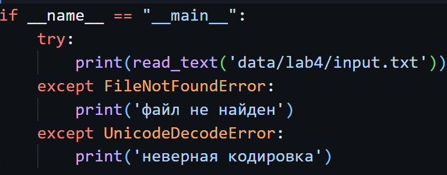
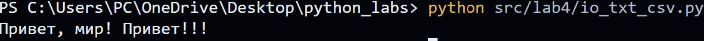
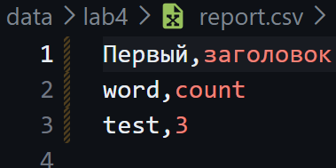
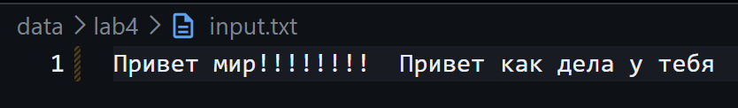
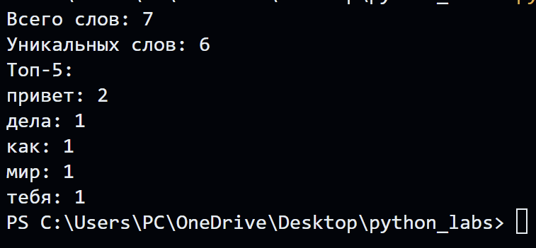
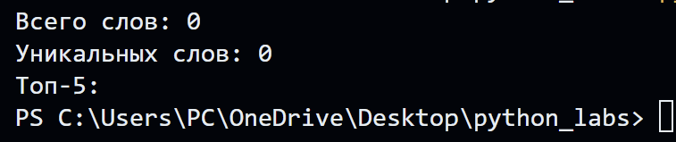
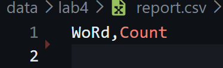

# ЛР4 — Файлы: TXT/CSV и отчёты по текстовой статистике
## Задание A — модуль src/lab04/io_txt_csv.py
## Функция read_text
**Кодировка** по умолчанию - UTF-8  
- Функция открывает файл на чтение в указанной кодировке и возвращает содержимое как `одну строку.`  
- Если **файл пустой** - возвращает пустую строку  
- Если **файл не найден** - `FileNotFoundError`  
- Если **не** та кодировка - `UnicodeDecodeError`  
  
Чтобы выбрать кодировку,ее нужно передать явно в метод read_text в виде `str().`




## Функция write_csv
- Функция создает/перезаписывает CSV с разделителем `",".`  
- Если передан header, записывает его `первой` строкой.  
- Строки и заголовок должны быть **одинаковой** длины, иначе - `ValueError`  
- Если на вход пустые rows и header=None - создаётся пустой файл (0 строк).   
- Если на вход пустые rows и header=("a","b") - в файле только `a,b`  

Команда запуска:
```python 
 write_csv([("word","count"),("test",3)],"data/lab4/report.csv",('Первый',"заголовок"))
  ```  
В файле report.csv:  



## Задание B — скрипт src/lab04/text_report.py
- Чтение одного входного файла `data/lab4/input.txt`  
- Текст нормализуется и токенизируется с помощью импорта функций `normalize, tokenize, count_freq, top_n` из `src/lib/text.py`.    
- Cчитается частота слов, а отчёт сохраняется в report.csv с колонками "word" и "count" ,отсортированными по убыванию частоты и по алфавиту при равенстве.  
  
В консоль печатает краткое резюме:  
    Всего слов: <...>  
    Уникальных слов: <...>  
    Топ-5:   




- Если data/input.txt **не существует** - `FileNotFoundError`  
- Если пустой вход в report.csv - файл будет содержать только заголовок.  



Чтобы передать `нестандартную кодировку` (cp1251) - нужно записать ее в виде str в начале скрипта в ENcoDing   

Функция `sorted_word_counts` возвращает список отсортировнаных кортежей count ↓, слово ↑ (при равенстве).  
