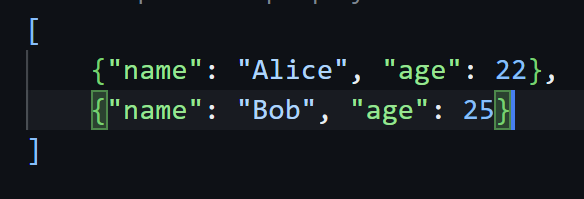
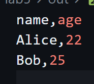
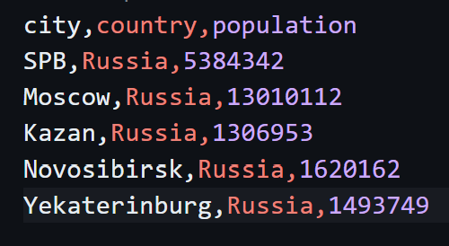
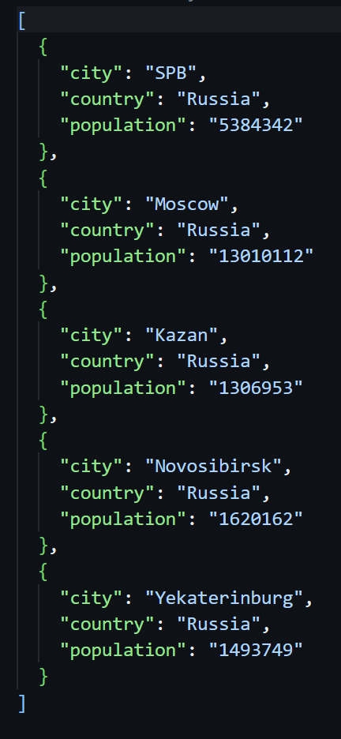
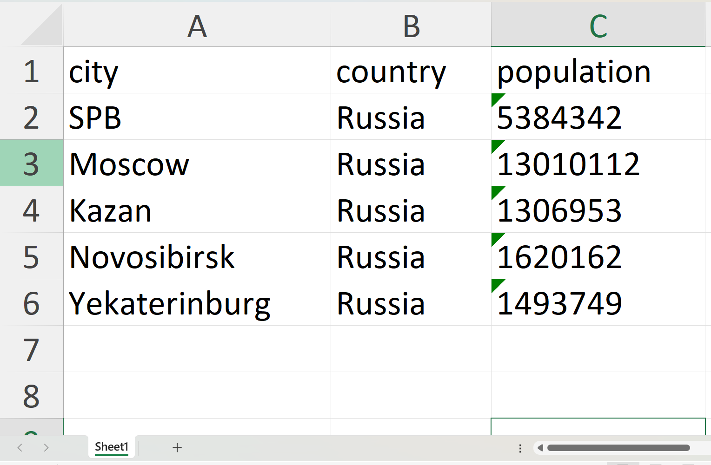
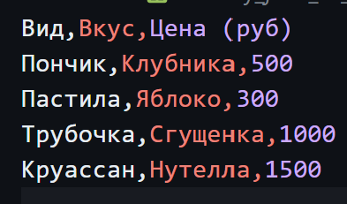
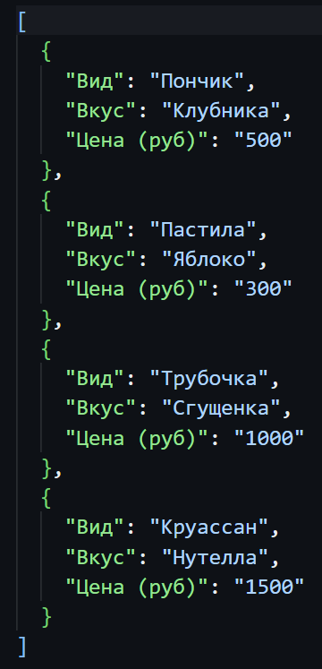
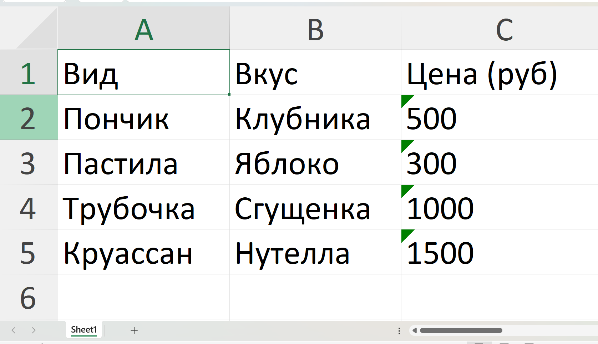

# ЛР5 — JSON и конвертации (JSON↔CSV, CSV→XLSX): Техническое задание
##  Задание А — JSON ↔ CSV : модуль src/lab05/json_csv.py
## Функция json_to_csv
``` python 
def json_to_csv(json_path: str, csv_path: str) -> None:
    """
    Преобразует JSON-файл в CSV.
    Поддерживает список словарей [{...}, {...}], заполняет отсутствующие поля пустыми строками.
    Кодировка UTF-8. Порядок колонок — как в первом объекте или алфавитный (указать в README).
    """
    json_f=Path(json_path)
    csv_f=Path(csv_path)
    
    if not json_f.exists():
        raise FileNotFoundError("файл не найден")
    
    if not csv_f.exists():
            raise FileNotFoundError("файл не найден")
        
    if json_f.suffix.lower() != ".json":
        raise ValueError('Входной файл должен быть JSON')
    
    if csv_f.suffix.lower() != ".csv":
        raise ValueError("Входной файл должен быть CSV")
    
    with json_f.open ("r",encoding='UTF-8') as f:
        try:
            data = json.load(f)
        except json.JSONDecodeError:
            raise ValueError("Пустой JSON / неподдерживаемая структура")
        
    if not isinstance(data, list) or len(data) == 0:
        raise ValueError('Файл JSON пустой / имеет неправильный формат')
    
    if not all(isinstance(i, dict) for i in data):
        raise ValueError("Все элементы списка JSON должны быть словарями")
    
    fieldnames = {}
    for element in data:
        for key in element.keys():
            fieldnames[key] = None

    with csv_f.open('w', newline="", encoding='utf-8') as f:
        w = csv.DictWriter(f, fieldnames=list(fieldnames.keys()))
        w.writeheader()
        w.writerows(data)
```
Команда запуска:
``` python 
python -m src.lab5.json_csv 
```
Принцип работы функции `json_to_csv:`
1. Ловит ошибки: 
    - `FileNotFoundError`
    - `ValueError` (неверный тип файла, пустой файл, неподдерживаемая структура)  
2. Превращает строковый путь к файлам в специальный умный объект (тип Path)
3. Превращает строки в Python-объект
4. Заполняет отсутствующие поля **пустыми** строками
5. Создает словарь с заголовками, записывая названия всех ключей **в порядке их появления**
6. Сохраняет в CSV **cтрого** в кодировке UTF-8 (заголовки, потом строки)
  
Было:  
  
  
Результат работы функции появляется в файле `people_from_json1.csv`:  
  


## Функция csv_to_json
``` python 
def csv_to_json(csv_path: str, json_path: str) -> None:
    """
    Преобразует CSV в JSON (список словарей).
    Заголовок обязателен, значения сохраняются как строки.
    json.dump(..., ensure_ascii=False, indent=2)
    """
    csv_fi=Path(csv_path)
    json_fi=Path(json_path)
    
    if not csv_fi.exists():
        raise FileNotFoundError("CSV Файл не найден")
    
    if not json_fi.exists():
            raise FileNotFoundError("JSON Файл не найден")
        
    if csv_fi.suffix.lower() != ".csv":
            raise ValueError("Входной файл должен быть CSV")
        
    if json_fi.suffix.lower() != ".json":
        raise ValueError("Входной файл должен быть JSON")
    
    with csv_fi.open('r',encoding='UTF-8',newline='') as f:
        row = csv.DictReader(f)
        if row.fieldnames is None:
            raise ValueError("CSV не содержит заголовок")
        rows=list(row)
        
        if len(rows) == 0:
            raise ValueError("В CSV не содержится данных")
        
        with json_fi.open("w", encoding="utf-8") as f:
            json.dump(rows, f, ensure_ascii=False, indent=2)
```
Команда запуска:
``` python 
python -m src.lab5.json_csv 
```

Принцип работы функции `csv_to_json`:
1. Ловит ошибки:
    - `FileNotFoundError`
    -  `ValueError` (входной файл неправильного формата; CSV не содержит заголовок или данных)
2. Берет **первую** строку файла и превращает ее слова в заголовки (ключи словаря). Записывает остальные строки данных как словари.
3. Сохраняет в JSON **строго** в кодировке UTF-8 список словарей
4. Записывает все данные внутрь открытого файла f (в режиме записи **"w"**):  
    - Чтобы киррилица осталась киррилицой: `ensure_ascii=False`
    - `indent=2` делает красивые отступы в начале строк.  

Было:  
  
  
Результат работы функции csv_to_json находится в файле `cities3.json`  
  

## Задание B — CSV → XLSX  
## Функция csv_to_xlsx
``` python
def csv_to_xlsx(csv_path: str, xlsx_path: str) -> None:
    """
    Конвертирует CSV в XLSX.
    Библиотека openpyxl.
    Первая строка CSV — заголовок.
    Лист называется "Sheet1".
    Колонки — автоширина по длине текста (не менее 8 символов).
    """
    csv_file=Path(csv_path)
    xlsx_file=Path(xlsx_path)
    
    if not csv_file.exists():
            raise FileNotFoundError("CSV Файл не найден")
    if csv_file.suffix.lower() != ".csv":
                raise ValueError("Входной файл должен быть CSV")
    if xlsx_file.suffix.lower() != ".xlsx":
                    raise ValueError("Файл должен быть XLSX")
    
    wb = Workbook()
    ws = wb.active
    ws.title = "Sheet1" 
        
    with csv_file.open('r', newline='', encoding='utf-8') as f:
        for row in csv.reader(f):
            ws.append(row) 
        
    for col in ws.columns:
        max_len = 0
        for cell in col:
            if cell.value: #Проверка на пустоту
                val_len = len(str(cell.value))
                if val_len > max_len:
                    max_len = val_len
        col_letter = col[0].column_letter
        ws.column_dimensions[col_letter].width = max(max_len, 7)
            
    wb.save(xlsx_file)
```  

Команда запуска:
``` python 
python -m src.lab5.cvs_xlsx 
```  
Принцип работы функции `csv_to_xlsx`:
1. Ловит ошибки:
    - `FileNotFoundError`
    -  `ValueError` (входной файл неправильного формата; CSV не содержит заголовок или данных)

2. Создает лист в Excel и дает ему имя `"Sheet1"`
3. Читает csv файл и **построчно** добавляет в лист Excel
4. Ищет в каждом столбце таблицы **максимальную** длину ячейки и выравнивает столбец по ней
    - Если ячейка пустая или в ней меньше 7 символов -> ширина столбца **автоматичеки** 7 символов.
5. Excel файл сохраняется по указанному пути  

Было:  
   

Результат работы функции csv_to_xlsx находится в файле `cities.xlsx`:  
   
  
## Сценарии демонстрации
- `data\lab5\samples\my_example_bakery.json` - список выпечки в формате .json  
- `data\lab5\samples\my_example_bakery.csv` - тот же список в формате .csv  
- `data\lab5\out\bakery_json_to_.csv` - результат json -> csv   
- `data\lab5\out\bakery_csv_to_.json` - результат csv -> json  
- `data\lab5\out\bakery_csv_to_.xlsx` - результат csv -> xlsx  

## Проверка работы
Результат **json** -> **csv**  
  
  
  
1. Заголовок первой строкой
2. Кол-во строк в json = кол-во строк в csv
  
Результат **csv** -> **json**  
  
  
  
Кол-во ключи и количество объектов в csv = ключи и количество объектов в json  
  
Результат **csv** -> **xlsx**  
  
  
  
Все данные в таблице; Ширина колонок выровнена по самой длинной ячейке.  

