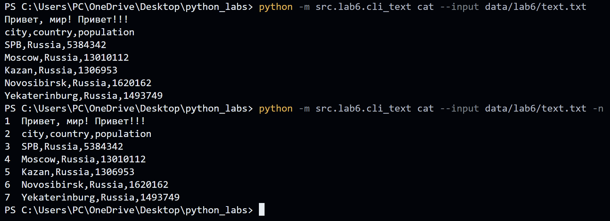
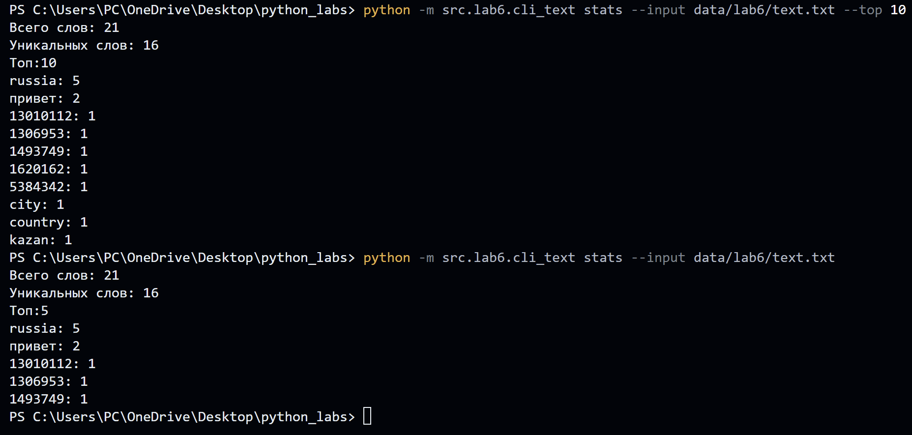
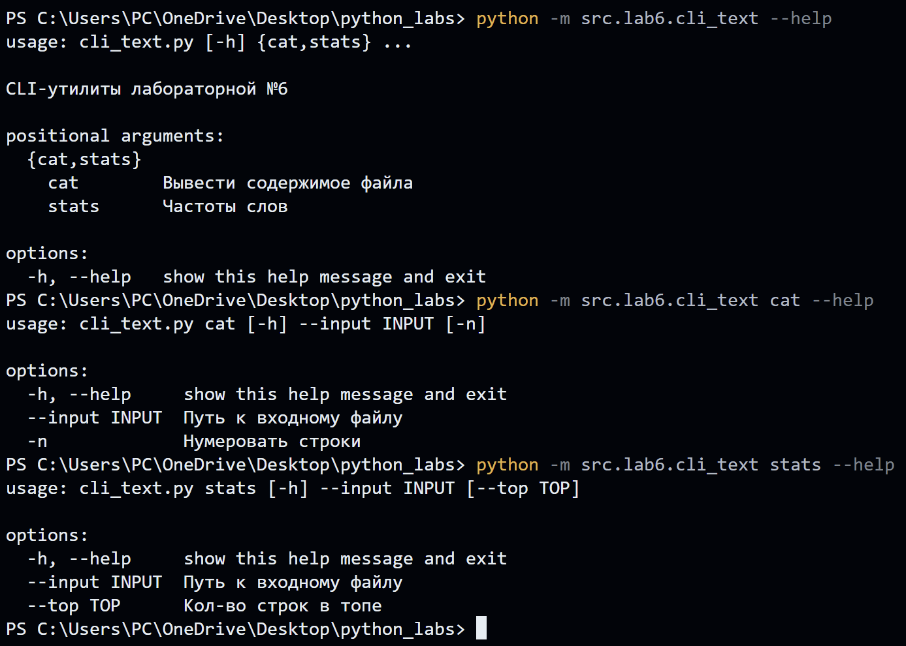
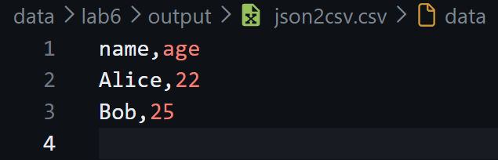
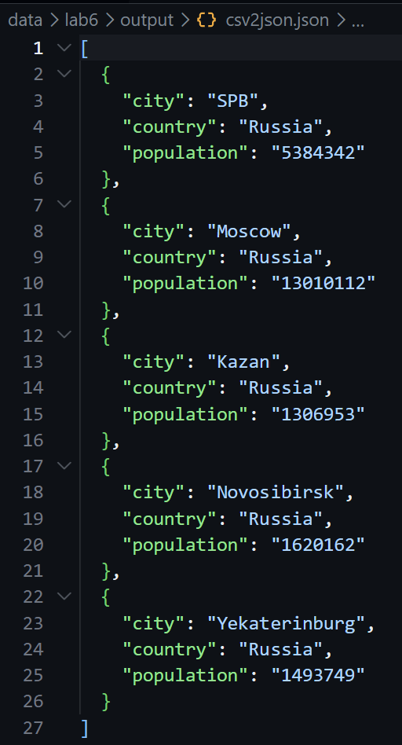
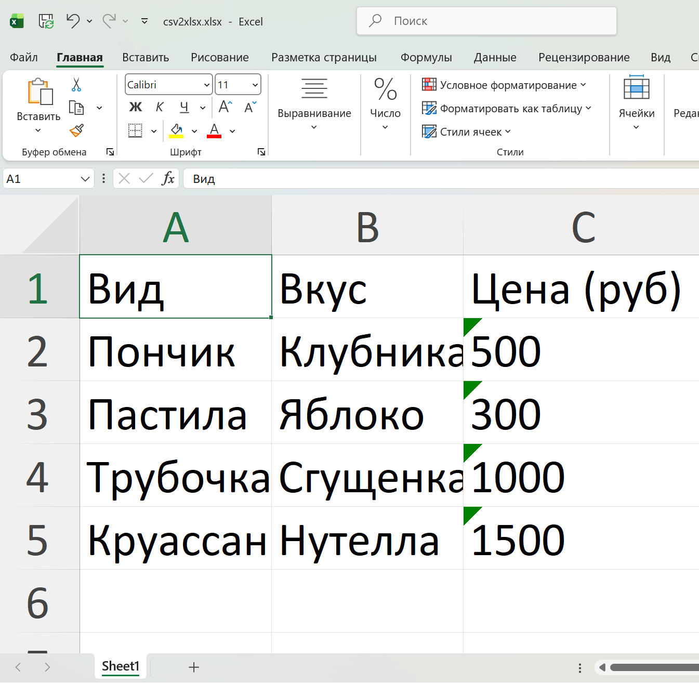
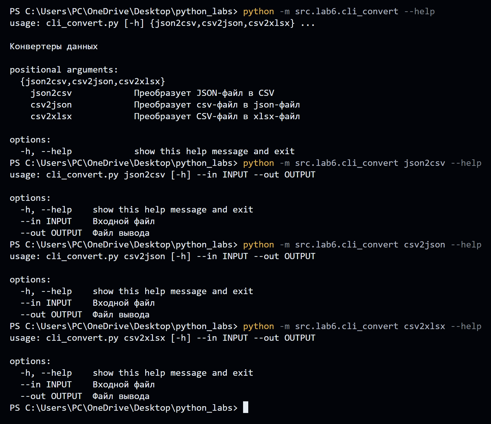

# ЛР6 — CLI‑утилиты с argparse (cat/grep‑lite + конвертеры): Техническое задание
## Модуль `src/lab6/cli_text.py`

```python
import argparse
from src.lib.text import read_text, normalize,tokenize,top_n,count_freq

def main():
    parser = argparse.ArgumentParser(description="CLI‑утилиты лабораторной №6")
    subparsers = parser.add_subparsers(dest="command")

    cat_parser = subparsers.add_parser("cat", help="Вывести содержимое файла")
    cat_parser.add_argument("--input", required=True, help='Путь к входному файлу')
    cat_parser.add_argument("-n", action="store_true", help="Нумеровать строки")

    stats_parser = subparsers.add_parser("stats", help="Частоты слов")
    stats_parser.add_argument("--input", required=True, help='Путь к входному файлу')
    stats_parser.add_argument("--top", type=int, default=5, help='Кол-во строк в топе')

    args = parser.parse_args()
```
## Подкоманда `cat`

``` python
if args.command == "cat":
        try:
            rows=read_text(args.input).splitlines()
        except FileNotFoundError:
            parser.error('Отсутствие входного файла')
            
        if args.n:
            for num, row in enumerate(rows,start=1):
                print(f'{num}  {row}')
        else:
            for row in rows:
                print(row)
```
Команда запуска **без нумерации строк**:  
``` python 
python -m src.lab6.cli_text cat --input data/lab6/text.txt
``` 
Команда запуска **с нумерацией строк**:  
``` python 
python -m src.lab6.cli_text cat --input data/lab6/text.txt -n
``` 

Вывод в терминале:  
  

## Подкоманда `stats`
```python
elif args.command == "stats":
        try:
            rows=read_text(args.input)
        except FileNotFoundError:
            parser.error('Отсутствие входного файла')
        if args.top<=0: parser.error('Параметр "top" должен быть больше 0')
            
        norm_text=normalize(rows)
        token=tokenize(norm_text)
        cnt=count_freq(token)
        topN=top_n(cnt,n=args.top)
        
        print(f'Всего слов: {len(token)}')
        print(f'Уникальных слов: {len(cnt)}')
        print(f'Топ:{args.top}')
        for kzh in topN:
            print(f'{kzh[0]}: {kzh[1]}')
```

Команда запуска **(с параметром top=10)**:  
``` python 
python -m src.lab6.cli_text stats --input data/lab6/text.txt --10 
``` 
Команда запуска **(Топ-5 по умолчанию)**:  
``` python 
python -m src.lab6.cli_text stats --input data/lab6/text.txt
```
Вывод в терминале:  
  

### _HELP_
  

## Модуль `src/lab6/cli_convert.py`
```python
import argparse
from src.lab5.json_csv import json_to_csv, csv_to_json
from src.lab5.cvs_xlsx import csv_to_xlsx
import json
import csv

def main():
    parser = argparse.ArgumentParser(description="Конвертеры данных")
    sub = parser.add_subparsers(dest="cmd")

    p1 = sub.add_parser("json2csv", help="Преобразует JSON-файл в CSV")
    p1.add_argument("--in", dest="input", required=True, help='Входной файл') 
    p1.add_argument("--out", dest="output", required=True,help='Файл вывода')

    p2 = sub.add_parser("csv2json", help="Преобразует csv-файл в json-файл")
    p2.add_argument("--in", dest="input", required=True, help='Входной файл')
    p2.add_argument("--out", dest="output", required=True,help='Файл вывода')

    p3 = sub.add_parser("csv2xlsx", help="Преобразует CSV-файл в xlsx-файл")
    p3.add_argument("--in", dest="input", required=True, help='Входной файл')
    p3.add_argument("--out", dest="output", required=True,help='Файл вывода')

    args = parser.parse_args()
```
## Подкоманды `json2csv, csv2json, csv2json`
``` python 
try:
        if args.cmd=='json2csv':
            json_to_csv(args.input,args.output)
        elif args.cmd=='csv2json':
            csv_to_json(args.input,args.output) 
        elif args.cmd=='csv2xlsx':
                csv_to_xlsx(args.input,args.output)  
    
    except FileNotFoundError as e:
        parser.error(str(e))
    except ValueError as e:
        parser.error(str(e))
```
## Команда запуска `json2csv:`  
```python
 python -m src.lab6.cli_convert json2csv --in data/lab5/samples/people1.json --out data/lab6/output/json2csv.csv
 ```

 Результат в файле `data/lab6/output/json2csv.csv:`   
 


 ## Команда запуска `csv2json:`  
```python
 python -m src.lab6.cli_convert csv2json --in data/lab5/samples/cities3.csv --out data/lab6/output/csv2json.json
 ```

 Результат в файле `data/lab6/output/csv2json.json:`  
 


 ## Команда запуска `csv2xlsx:`  
```python
python -m src.lab6.cli_convert csv2xlsx --in data/lab5/samples/my_example_bakery.csv --out data/lab6/output/csv2xlsx.xlsx
 ```

 Результат в файле `data/lab6/output/csv2xlsx.xlsx:`  
 

### _HELP_

